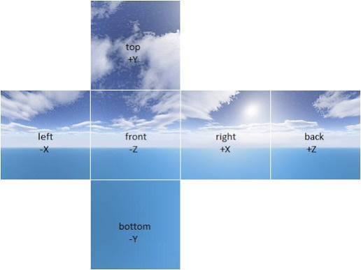

# Adding Realism
<h1>Week 06 | Oct 13 & 15, 2026</h1>

## Schedule

  * Week 6-1 (today): Dynamic Arrays, Manipulating Meshes
  * Week 6-2: Adding Realism
  * Week 7: Project B Presentations
  
## Project Brief

* [Project B: Virtual Environment](https://docs.google.com/document/d/1OH-SeNXuankDISuhR9uCAHy4ICLW5XCMwxEQlZJjT3E/edit?tab=t.yhnbndnromx3)

## Concepts and Activities

### Lecture

* Reminder: Manipulating meshes
* [Textures](https://threejs.org/docs/#api/en/textures/Texture)
  * [TextureLoader](https://threejs.org/docs/#api/en/loaders/TextureLoader)
    * [Particle textures](https://www.google.com/search?q=particle+texture&tbm=isch)
  * Sphere texture
    * SphereGeometry provides UV coordinates for mapping a 2D texture onto its surface.
    * Camera [FOV](https://threejs.org/docs/#api/en/cameras/PerspectiveCamera) controls the view, not the texture mapping.
  * Texture [properties](https://threejs.org/docs/#api/en/textures/Texture): offset, repeat, wrap, and rotation
  * Displacement is a material map, not a general Texture property: [displacementMap](https://threejs.org/docs/#api/en/materials/MeshStandardMaterial.displacementMap)
  * [VideoTexture](https://threejs.org/docs/#api/en/textures/VideoTexture)
  * [CanvasTexture](https://threejs.org/docs/#api/en/textures/CanvasTexture)
* [GLTFLoader](https://threejs.org/docs/#examples/en/loaders/GLTFLoader)
  * glTF (GL Transmission Format) loader
  * Import the loader add-on explicitly in module-based projects.
  * Loads `.gltf` and `.glb` files.
  * A glTF/GLB file can contain 3D models, materials, textures, scenes, and animations.
  * If you generate a 3D model with [Tripo AI](https://studio.tripo3d.ai/), export it as a `.glb` file for use with [Three.js](https://threejs.org/).
  * **glTF vs. GLB**
    * `.gltf`
      * The JSON-based form; it commonly references separate binary data and texture files.
      * Easier to inspect and edit manually.
      * May require managing multiple files.
    * `.glb`
      * The binary container form of glTF, which can package model data and resources together in a **single file**.
      * Easier to download, upload, and load in a web project when exported as a self-contained file.
      * **Recommended for our Three.js projects and Tripo AI exports.**
* [OBJLoader](https://threejs.org/docs/#examples/en/loaders/OBJLoader)
  * Import the loader add-on explicitly in module-based projects.
  * Loads `.obj` files.
  * `.obj` is a geometry-focused format; unlike glTF/GLB, it does not provide a standard way to store scene hierarchies or animations.
  * **Not** [ObjectLoader](https://threejs.org/docs/#api/en/loaders/ObjectLoader)! ObjectLoader is for JSON-formatted 3D objects, not `.obj` files.
* [CubeTexture](https://threejs.org/docs/#api/en/textures/CubeTexture)
  * A cube texture uses six images to represent the sides of a cube.
  * 
  * Some examples: [Humus Textures](http://www.humus.name/index.php?page=Textures)
* High Dynamic Range Image (HDRI) environment maps
  * PolyHaven [HDRIs](https://polyhaven.com/hdris)
  * [Adobe Stock](https://stock.adobe.com/hk/search?k=hdri+space)
  * Load HDR environment maps with [RGBELoader](https://threejs.org/docs/#examples/en/loaders/RGBELoader), then use them as a scene background or environment map.
* Reflection / Refraction
  * [Reflector](https://threejs.org/examples/?q=reflec#webgl_mirror)
  * [Refraction](https://threejs.org/examples/webgl_refraction.html)
* [MeshPhysicalMaterial](https://threejs.org/docs/#api/en/materials/MeshPhysicalMaterial)
  * A physically based material with additional effects such as clearcoat, transmission, and sheen.
  * [Example code](https://github.com/MOQN/IMA-Web-Page-To-Web-Space/tree/main/codes/06_adding_realism/16_MeshPhysicalMaterial) in the course GitHub repository
* Generate 3D models from [Tripo AI](https://studio.tripo3d.ai/)
  * Or download 3D objects and textures:
    * [TurboSquid](https://www.turbosquid.com/)
    * [Free3D](http://free3d.com)
    * [Thingiverse](https://www.thingiverse.com/)
    * [Sketchfab](https://sketchfab.com/)
    * [CGTrader](https://www.cgtrader.com/)

### Exercises

* Live-Coding with the concepts and techniques listed above.

## Assignment

### Project B: Virtual Environment

* [Link to the Project](https://docs.google.com/document/d/1OH-SeNXuankDISuhR9uCAHy4ICLW5XCMwxEQlZJjT3E/edit?tab=t.yhnbndnromx3)

?> Due **Oct 22, 2026 (Week 7)**

### Project B Async Conceptual Development

?> Due **Oct 19, 2026**

* [Slides for the Asynchronous Concept Proposal](https://docs.google.com/presentation/d/1anXWPMft_YOy7rtsTRBx8n9n4IDEKV6qWd05_gP0glU/edit?usp=sharing)

### Project B Proposals from Previous Semester

* [Neo Alabastro](https://docs.google.com/document/d/1sPaAdVZE7WMk3oYXchwstQDhT4qsjvj6k_QQM3x6nKw/edit?usp=drive_link)
* [Vivian Chen](https://docs.google.com/document/d/1IbC34ho9HkgF66ioyTjyppuujlMFnIahbqFG05NR9A4/edit?usp=drive_link)
* [Minjae Lee](https://docs.google.com/document/d/1R_05tYKi3TXLtOPKjSHL5am7lrK8GGWABTUIksET--s/edit?usp=drive_link)
* [Marissa Moreno](https://docs.google.com/document/d/1YMe1yD7aVGC3ZB0faH_DdarMioKrT7mzoK3z7fJu58s/edit?usp=drive_link)
* [Jaidyn Perry](https://docs.google.com/document/d/1Ijo46lrpLReXWA0f_4IeLD8whfmoYHSawG-JyW6psys/edit?usp=drive_link)
* [Emy Sainbayar](https://docs.google.com/document/d/16aSwcb3-1NJ0-PYg2mr0z8boyuFbQR0L6a0aNstntJk/edit?usp=drive_link)
* [Vivian Xinwei Xie](https://docs.google.com/document/d/1c3Ccw9TBu2koVPP7QVIefPKTcACLBnMHIOzK2TIhh8k/edit?usp=drive_link)
* [Ash Guoxi Yang](https://docs.google.com/document/d/1odUsFRvPre-wBMtC6SueWQCcf_tKQBnR6LUd9jezLns/edit?usp=drive_link)
* [Andy Jinran Ye](https://docs.google.com/document/d/1qP95L91CcHDIs-9bT8_nwDliZDy1x6LecA3DPuRSyZI/edit?usp=drive_link)
* [Anya Zhukova](https://docs.google.com/document/d/1XxpfwmpMXT0Ofwe4SVCTfCYSSIfwN1Hut2r0SRygnow/edit?usp=drive_link)